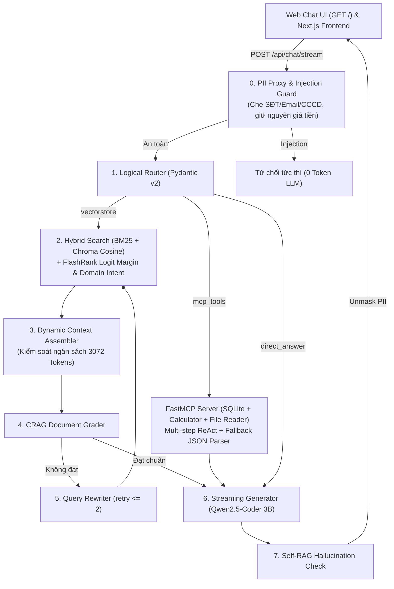

# 🤖 Local Agentic RAG & MCP Assistant (`v1.0`)

Hệ thống **Local Agentic RAG** chuẩn Production vận hành hoàn toàn trên máy cá nhân (On-premise), kết hợp **LangGraph Adaptive CRAG**, **Hybrid Search (BM25 + Chroma Cosine + FlashRank)**, **Dynamic Context Assembler**, **PII Security Proxy**, **FastMCP Tools** và **FastAPI SSE Streaming** — tối ưu hóa cho phần cứng giới hạn (CPU / iGPU) với **Ollama (`qwen2.5-coder:3b` & `nomic-embed-text`)**.

---

## 🧭 Kiến trúc Hệ thống



---

## ✨ Điểm nhấn Kỹ thuật Nổi bật

1. **PII Proxy & Prompt Injection Guard ([src/utils/pii_proxy.py](src/utils/pii_proxy.py)):**
   * Tự động phát hiện và tráo đổi SĐT Việt Nam (hỗ trợ cả định dạng 4-3-3 và 3-3-4), Email, CCCD 12 số (`001`–`096`), CMND 9 số có ngữ cảnh sang mã UUID tạm thời trên RAM, **không che nhầm giá tiền VNĐ** (ví dụ `106020000`).
   * Chặn ngay các mẫu Prompt Injection / SQL Injection trước khi dữ liệu chạm tới Ollama hoặc MCP Server.
2. **Contextual Chunking & Hybrid Reranking ([src/rag/indexing.py](src/rag/indexing.py), [src/rag/hybrid_retriever.py](src/rag/hybrid_retriever.py)):**
   * Chia nhỏ tài liệu bằng `MarkdownHeaderTextSplitter` + `RecursiveCharacterTextSplitter`, gắn tiền tố `[Mục: h1 / h2 / h3]` riêng biệt cho từng chunk và metadata `doc_domain` để chống ô nhiễm từ khóa (*Keyword Pollution*).
   * `EnsembleRetriever` (**BM25** `k=5`, trọng số `0.4` + **Chroma Cosine** `k=5`, trọng số `0.6`) kèm khôi phục `BM25Retriever` trực tiếp từ ChromaDB khi restart server.
   * **FlashRank Cross-Encoder (`ms-marco-MultiBERT-L-12`)** trên CPU kết hợp **Logit Margin & Domain Intent Scoring** + khử trùng lặp Jaccard.
3. **Dynamic Context Assembler ([src/utils/context_assembler.py](src/utils/context_assembler.py)):**
   * Ước lượng token tiếng Việt/code ngoại tuyến, phân bổ ngân sách cứng trên cửa sổ `3072` tokens để bảo vệ KV-Cache trên mô hình 3B.
4. **Adaptive CRAG, Self-RAG, MCP Tools & Durable HITL ([src/agent/graph.py](src/agent/graph.py), [mcp_server/](mcp_server/project_mcp_server.py)):**
   * Đồ thị trạng thái `LangGraph` với chốt chặn `retry_count <= 2`.
   * **Durable State Machine & Human-in-the-Loop (HITL):** Lưu trạng thái bền vững qua `AsyncSqliteSaver` tại `data/langgraph_checkpoints.sqlite`, tạm dừng trước node `commit_erp_order` (`interrupt_before=["commit_erp_order"]`) để chờ phê duyệt/chỉnh sửa số lượng qua `POST /api/erp/approve` trước khi trừ kho `erp_inventory.db`.
   * `FastMCP` cung cấp 3 công cụ thật (`query_erp_inventory` dùng SQLite, `calculate_order_total`, `read_technical_doc`), tích hợp vòng lặp **Multi-step ReAct + Fallback JSON Parser** cho model nhỏ.
5. **FastAPI SSE Streaming & Built-in Web UI ([src/api/main.py](src/api/main.py)):**
   * Hỗ trợ `thread_id` và sự kiện SSE `approval_required` khi luồng ERP cần xác nhận từ người dùng. Xem chi tiết tại [API_CONTRACT.md](API_CONTRACT.md).

---

## 📂 Cấu trúc Thư mục

```text
local-agentic-rag/
├── data/                        # Tài liệu .md mẫu & CSDL SQLite erp_inventory.db
├── src/
│   ├── config.py                # Cấu hình Ollama, ChromaDB, FlashRank, max_retries
│   ├── rag/
│   │   ├── indexing.py          # Markdown chunking + Contextual Headers + doc_domain
│   │   └── hybrid_retriever.py  # BM25 + Chroma Cosine + FlashRank Logit Margin Filter
│   ├── agent/
│   │   ├── state.py             # GraphState & Pydantic v2 Schemas
│   │   ├── nodes.py             # Router, Retrieve, CRAG Grader, Query Rewriter, Generate, Self-RAG
│   │   └── graph.py             # LangGraph StateGraph DAG
│   ├── utils/
│   │   ├── context_assembler.py # Dynamic Context Assembler (Token Budget)
│   │   └── pii_proxy.py         # PII Masking & Prompt Injection Guard
│   └── api/
│       └── main.py              # FastAPI SSE Streaming + Web Chat UI (GET /)
├── mcp_server/
│   ├── project_mcp_server.py    # FastMCP server (SQLite, Calculator, Doc Reader)
│   └── mcp_client_bridge.py     # Multi-step ReAct + Fallback JSON Parser
├── evaluation/
│   ├── evaluate_rag.py          # Đánh giá định lượng bằng RAGAS
│   ├── trajectory_eval.py       # Bộ chấm điểm Quỹ đạo (Golden DAG)
│   └── ragas_evaluation_report.csv
├── tests/
│   ├── test_pii_proxy.py        # Unit tests cho PIIProxy & Prompt Injection Guard
│   └── test_trajectory_ci.py    # Offline CI Gate: Trajectory, CRAG & Durable HITL SQLite tests
├── API_CONTRACT.md              # Tài liệu tích hợp cho Frontend Next.js
├── requirements.txt
└── .gitignore
```

---

## 🚀 Hướng dẫn Cài đặt & Chạy Hệ thống

### 1. Cài đặt Ollama & Tải Mô hình Local
```powershell
ollama pull nomic-embed-text
ollama pull qwen2.5-coder:3b
```

### 2. Cài đặt Môi trường Python 3.10+
```powershell
cd local-agentic-rag
python -m venv .venv
.\.venv\Scripts\Activate.ps1
pip install -r requirements.txt
```

### 3. Nạp dữ liệu vào ChromaDB (Re-index)
```powershell
python -m src.rag.indexing
```

### 4. Khởi động Backend & Giao diện Web Chat
```powershell
uvicorn src.api.main:app --host 0.0.0.0 --port 8000
```
Mở trình duyệt tại **`http://localhost:8000/`** để chat trực tiếp với luồng **SSE Streaming**, hoặc xem tài liệu API tại **`http://localhost:8000/docs`**.

---

## 🧪 Kiểm thử & Đánh giá Định lượng (CI Gate & RAGAS)

* **Chạy Offline CI Gate (PII Proxy + Trajectory Eval + Durable HITL SQLite, không cần Ollama):**
  ```powershell
  pytest tests/test_pii_proxy.py tests/test_trajectory_ci.py -v
  ```
  Kết quả đã kiểm chứng: **`13 passed in 2.24s`** (3 test PII Proxy + 8 test Trajectory/CRAG/MCP + 2 test Durable HITL `AsyncSqliteSaver` phê duyệt/chỉnh số lượng và từ chối giữ nguyên tồn kho).
* **Chạy kiểm thử End-to-End (MCP Tools + Hybrid RAG):**
  ```powershell
  python test_e2e_live.py
  ```
* **Chạy chấm điểm RAGAS (`RunConfig(max_workers=1, timeout=180)`):**
  ```powershell
  python -m evaluation.evaluate_rag
  ```

### Kết quả Benchmark Thực tế (`qwen2.5-coder:3b` trên CPU / Intel HD Graphics 620)
Dữ liệu ghi nhận trực tiếp từ [evaluation/ragas_evaluation_report.csv](evaluation/ragas_evaluation_report.csv) (lượt chạy sau khi nâng cấp `GradeDocuments` CoT):
* **`context_recall`:** `1.0000` (đạt `1.0000` trên cả Câu 1 và Câu 2).
* **`answer_relevancy`:** `0.8841` (Câu 1: `0.8837`, Câu 2: `0.8845`).
* **`context_precision`:** `0.5000` (Câu 2 đạt `1.0000`; Câu 1 đạt `0.0000` do model 3B ở `grade_documents` chấm `NO` với chunk #2 `rag_architecture.md` và giữ lại chunk #3 `product_specs.md`).
* **`faithfulness`:** `0.5000` (Câu 2 đạt `1.0000`, Câu 1 đạt `0.0000`).
* **Kiểm thử MCP End-to-End:** Agent tự động chuỗi hóa 2 bước `query_erp_inventory('AI-WS-X1')` $\rightarrow$ `calculate_order_total(58900000, 2, 10)` và trả về chính xác `14 chiếc` / `106,020,000 VNĐ`.
