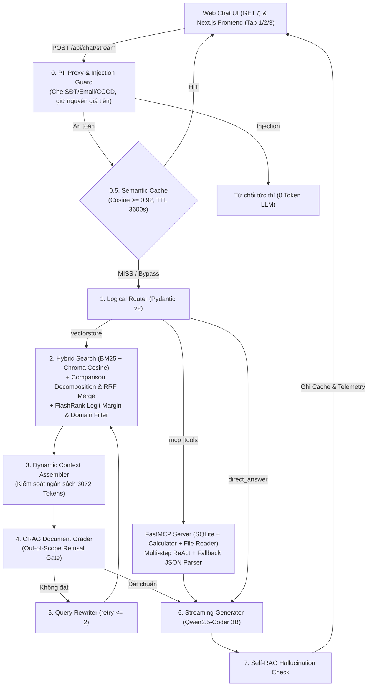

# 🤖 Local Agentic RAG & MCP Assistant (`v2.0`)

[](https://github.com/phidanghai-spec/local-agentic-rag/actions/workflows/trajectory-eval-ci.yml)

> **Deep Dive:** Đọc bài phân tích kiến trúc & nhật ký gỡ lỗi thực chiến trên model 3B tại [**`docs/ARCHITECTURE_TEARDOWN.md`**](./docs/ARCHITECTURE_TEARDOWN.md).

Hệ thống **Local Agentic RAG v2.0** chuẩn Production vận hành hoàn toàn trên máy cá nhân (On-premise), kết hợp **LangGraph Adaptive CRAG**, **Hybrid Search (BM25 + Chroma Cosine + FlashRank)**, **Comparison Query Decomposition (RRF Merge)**, **Semantic Cache ChromaDB**, **Telemetry Store (Mini-LangSmith)**, **Incremental Document Ingestion (SHA-256 Manifest)**, **PII Security Proxy**, **FastMCP Tools** và **FastAPI SSE Streaming** — tối ưu hóa cho phần cứng giới hạn (CPU / iGPU) với **Ollama (`qwen2.5-coder:3b` & `nomic-embed-text`)**.

---

## 🧭 Kiến trúc Hệ thống



---

## ✨ Điểm nhấn Kỹ thuật Nổi bật (v2.0)

1. **Semantic Cache ([src/utils/semantic_cache.py](src/utils/semantic_cache.py)):**
   * Lưu trữ câu trả lời đã thẩm định qua ChromaDB vector cosine similarity (`>= 0.92`), TTL cấu hình được (mặc định 3600s).
   * Tự động bypass các truy vấn ERP/tồn kho/chốt đơn hoặc truy vấn chứa PII để đảm bảo tính thời gian thực và an toàn dữ liệu. Hỗ trợ xóa cache qua `DELETE /api/cache`.
2. **Telemetry Store Offline ([src/utils/telemetry.py](src/utils/telemetry.py)):**
   * Đóng vai trò Mini-LangSmith chạy SQLite cục bộ, tự động thu thập trace từng node, latency p50/p95, tỷ lệ hit cache, và số lượt Human-in-the-loop. Expose qua `GET /api/metrics` và `GET /api/traces`.
3. **Quản lý Tài liệu Đa định dạng & Incremental Manifest ([src/rag/indexing.py](src/rag/indexing.py)):**
   * Hỗ trợ `.md`, `.txt`, `.pdf` (lazy-import `pypdf`).
   * Theo dõi thay đổi tệp qua SHA-256 Manifest (`data/ingestion_manifest.json`), tránh re-index tệp chưa thay đổi. Expose qua `GET /api/documents` và `POST /api/documents/upload`.
4. **Comparison Query Decomposition & Refusal Gate ([src/rag/hybrid_retriever.py](src/rag/hybrid_retriever.py), [src/agent/nodes.py](src/agent/nodes.py)):**
   * Phân tách câu hỏi so sánh thành các truy vấn đơn và hợp nhất qua Reciprocal Rank Fusion (RRF), đảm bảo truy xuất công bằng cả 2 thực thể.
   * Chốt chặn từ chối dứt khoát khi `0/N` chunk đạt chuẩn (không ép giữ chunk sai sản phẩm).
5. **PII Proxy & Prompt Injection Guard ([src/utils/pii_proxy.py](src/utils/pii_proxy.py)):**
   * Tự động phát hiện và tráo đổi SĐT Việt Nam, Email, CCCD 12 số, CMND 9 số sang mã UUID tạm thời trên RAM, không che nhầm giá tiền VNĐ.
   * Chặn ngay Prompt Injection trước khi dữ liệu chạm tới đồ thị agent.
6. **Durable State Machine & Human-in-the-Loop (HITL) ([src/agent/graph.py](src/agent/graph.py)):**
   * Lưu trạng thái qua `AsyncSqliteSaver`, tạm dừng trước `commit_erp_order` để người dùng xác nhận hoặc sửa số lượng/chiết khấu qua `POST /api/erp/approve`.
   * Khóa Idempotency chống ghi trùng giao dịch vào `data/erp_inventory.db`.

---

## 📂 Cấu trúc Thư mục

```text
local-agentic-rag/
├── data/                        # Tài liệu mẫu & CSDL SQLite erp_inventory.db
├── src/
│   ├── config.py                # Cấu hình Ollama, ChromaDB, FlashRank, max_retries
│   ├── rag/
│   │   ├── indexing.py          # Markdown/PDF chunking + SHA-256 Manifest + doc_domain
│   │   └── hybrid_retriever.py  # BM25 + Chroma Cosine + Comparison RRF + FlashRank
│   ├── agent/
│   │   ├── state.py             # GraphState & Pydantic v2 Schemas
│   │   ├── nodes.py             # Router, Retrieve, CRAG Grader, Query Rewriter, Generate, Self-RAG
│   │   └── graph.py             # LangGraph StateGraph DAG (Durable HITL)
│   ├── utils/
│   │   ├── context_assembler.py # Dynamic Context Assembler (Token Budget)
│   │   ├── pii_proxy.py         # PII Masking & Prompt Injection Guard
│   │   ├── semantic_cache.py    # Semantic Cache ChromaDB (Cosine >= 0.92, TTL)
│   │   └── telemetry.py         # TelemetryStore SQLite (p50/p95, traces, HITL audit)
│   └── api/
│       └── main.py              # FastAPI Backend (SSE Streaming, Documents, Cache, Telemetry)
├── mcp_server/
│   ├── project_mcp_server.py    # FastMCP server (SQLite, Calculator, Doc Reader)
│   └── mcp_client_bridge.py     # Multi-step ReAct + Fallback JSON Parser
├── evaluation/
│   ├── evaluate_rag.py          # Đánh giá định lượng bằng RAGAS
│   ├── trajectory_eval.py       # Bộ chấm điểm Quỹ đạo (Golden DAG)
│   └── ragas_evaluation_report.csv
├── tests/
│   ├── test_pii_proxy.py        # Unit tests cho PIIProxy & Prompt Injection Guard
│   ├── test_semantic_cache.py   # Unit tests cho Semantic Cache & TTL
│   ├── test_telemetry_and_idempotency.py # Tests cho Telemetry & Idempotent ERP
│   ├── test_ingestion.py        # Tests cho SHA-256 Manifest, PDF, Chunking & Ingestion
│   ├── test_trajectory_ci.py    # Offline CI Gate: Trajectory, CRAG, Comparison & HITL
│   └── test_api_integration.py # Offline FastAPI TestClient Integration Tests
├── Dockerfile                   # Dockerfile cho Backend FastAPI
├── docker-compose.yml           # Compose Backend (8000), Frontend (3000), Ollama (11434)
├── .dockerignore
├── API_CONTRACT.md              # Tài liệu đặc tả API v2.0
├── requirements.txt
├── requirements-ci.txt
└── .gitignore
```

---

## 🚀 Hướng dẫn Cài đặt & Khởi chạy

### Cách 1: Khởi chạy bằng Docker & Docker Compose (Khuyên dùng)

```powershell
# 1. Khởi động Backend (8000) và Frontend (3000)
docker compose up -d --build

# 2. Hoặc khởi động kèm luôn service Ollama trong Docker (profile `ollama`)
docker compose --profile ollama up -d --build
```

### Cách 2: Chạy trực tiếp trên máy (Local Dev)

#### 1. Cài đặt Ollama & Tải Mô hình Local
```powershell
ollama pull nomic-embed-text
ollama pull qwen2.5-coder:3b
```

#### 2. Cài đặt Môi trường Python 3.10+
```powershell
cd local-agentic-rag
python -m venv .venv
.\.venv\Scripts\Activate.ps1
pip install -r requirements.txt
```

#### 3. Nạp dữ liệu vào ChromaDB (Re-index)
```powershell
python -m src.rag.indexing
```

#### 4. Khởi động Backend FastAPI
```powershell
uvicorn src.api.main:app --host 0.0.0.0 --port 8000
```
Mở trình duyệt tại **`http://localhost:8000/`** để kiểm thử SSE Streaming trực tiếp, hoặc xem Swagger UI tại **`http://localhost:8000/docs`**.

---

## 🧪 Bộ Kiểm thử Tự động (Full Test Suite)

Chạy toàn bộ 53 offline test cases (không cần Ollama, không làm biến đổi CSDL `data/erp_inventory.db`):
```powershell
$env:PYTHONPATH="."
pytest tests/ -v --tb=short
```

Toàn bộ **53/53 test cases** đều pass:
- `tests/test_api_integration.py`: 8 tests (Health, Cache Delete, Metrics, Traces, Document List/Upload, SSE Token Streaming, Injection Block, ERP Approve Validation)
- `tests/test_pii_proxy.py`: 3 tests (PII masking/unmasking, CMND 9 số, Injection block)
- `tests/test_semantic_cache.py`: 10 tests (Exact/near-duplicate hit, TTL eviction, ERP bypass, PII bypass)
- `tests/test_telemetry_and_idempotency.py`: 7 tests (SQLite traces, p50/p95, Idempotent ERP commit, list_erp_orders)
- `tests/test_ingestion.py`: 11 tests (Markdown, TXT, PDF lazy-import, SHA-256 Manifest incremental skip/reindex)
- `tests/test_trajectory_ci.py`: 14 tests (Golden DAG trajectory, CRAG loop, HITL durable state, Comparison decomposition, Out-of-scope refusal)

* **Chạy kiểm thử End-to-End (MCP Tools + Hybrid RAG):**
  ```powershell
  python test_e2e_live.py
  ```
* **Chạy chấm điểm RAGAS (`RunConfig(max_workers=1, timeout=180)`):**
  ```powershell
  python -m evaluation.evaluate_rag
  ```

### Kết quả Benchmark Thực tế (`qwen2.5-coder:3b` trên CPU / Intel HD Graphics 620)
Dữ liệu ghi nhận trực tiếp từ [evaluation/ragas_evaluation_report.csv](evaluation/ragas_evaluation_report.csv) (lượt chạy sau khi nâng cấp `GradeDocuments` CoT):
* **`context_recall`:** `1.0000` (đạt `1.0000` trên cả Câu 1 và Câu 2).
* **`answer_relevancy`:** `0.8841` (Câu 1: `0.8837`, Câu 2: `0.8845`).
* **`context_precision`:** `0.5000` (Câu 2 đạt `1.0000`; Câu 1 đạt `0.0000` do model 3B ở `grade_documents` chấm `NO` với chunk #2 `rag_architecture.md` và giữ lại chunk #3 `product_specs.md`).
* **`faithfulness`:** `0.5000` (Câu 2 đạt `1.0000`, Câu 1 đạt `0.0000`).
* **Kiểm thử MCP End-to-End:** Agent tự động chuỗi hóa 2 bước `query_erp_inventory('AI-WS-X1')` $\rightarrow$ `calculate_order_total(58900000, 2, 10)` và trả về chính xác `14 chiếc` / `106,020,000 VNĐ`.
