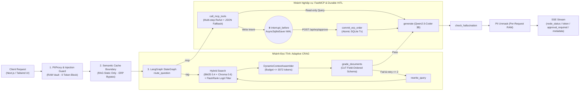

# Architecture Teardown: Local Agentic RAG & MCP Assistant (v1.0.0)

> **Hệ thống:** Local Agentic RAG & FastMCP ERP Assistant  
> **Phiên bản phân tích:** `v1.0.0` (Commit `8532697` · 34 tệp nguồn · 13/13 Offline CI Gate)  
> **Ràng buộc mục tiêu:** 100% On-premise/Offline · Đồ họa tích hợp Intel HD Graphics 620 · LLM `qwen2.5-coder:3b` · Ngân sách ngữ cảnh `3072 tokens`

Tài liệu này mổ xẻ các quyết định thiết kế, sự đánh đổi kỹ thuật (engineering trade-offs) và **4 lỗi thực tế đã phát hiện — gỡ bỏ khi vận hành mô hình nhỏ 3B trên phần cứng giới hạn**. Thay vì chỉ trình bày kết quả cuối cùng, tài liệu giữ nguyên cả các mốc chỉ số RAGAS bị tụt điểm và phân tích nguyên nhân gốc rễ từ log thực thi.

---

## 1. Bối cảnh & Bài toán Ràng buộc (Constraints-First Design)

Hầu hết các bản mẫu Agentic RAG hiện nay mặc định sử dụng API đám mây (GPT-4o, Claude 3.5) với cửa sổ ngữ cảnh 128k tokens và khả năng gọi hàm (function calling) ổn định. Khi đưa kiến trúc này xuống môi trường **nội bộ 100% offline** trên máy trạm văn phòng không có GPU rời (**Intel HD Graphics 620**), 4 ràng buộc cứng lập tức xuất hiện:

| Ràng buộc hạ tầng | Hệ quả nếu dùng kiến trúc RAG thông thường | Quyết định kiến trúc đã áp dụng |
| :--- | :--- | :--- |
| **LLM nhỏ (`qwen2.5-coder:3b`)** | Hay lỗi cú pháp JSON khi gọi tool, dễ bị thiên kiến khi chấm điểm tài liệu và dễ lặp vòng vô hạn | Bọc Pydantic v2 Schema theo thứ tự CoT, Fallback JSON Parser, giới hạn cứng `retry_count <= 2` |
| **Cửa sổ ngữ cảnh hẹp (`3072 tokens`)** | Nhồi nhiều chunk hoặc prompt dài gây tràn ngữ cảnh, làm chậm tốc độ sinh token trên CPU/iGPU | Xây dựng `DynamicContextAssembler` ước lượng token tiếng Việt/code offline để phân bổ ngân sách cứng |
| **Dữ liệu nhạy cảm & nghiệp vụ ERP** | Nguy cơ rò rỉ SĐT/Email/CCCD vào vector cache và rủi ro LLM tự ý trừ tồn kho SQLite sai lệch | Đặt `PIIProxy` trước cổng vào; tách nhánh ghi `commit_erp_order` sau cổng `interrupt_before` (HITL) |
| **CI Runner không có GPU (`ubuntu-latest`)** | Không thể chạy Ollama trên GitHub Actions, dẫn đến dễ hồi quy khi sửa cạnh LangGraph hay công thức MCP | Thiết kế **Trajectory Eval CI Gate** với Lazy Imports + `FakeDeterministicLLM` + SQLite Sandbox (`2.24s`) |

---

## 2. Kiến trúc Tổng thể & Biên giới Dữ liệu

Hệ thống được phân tầng rõ ràng theo nguyên tắc **chặn sớm trước khi chạm tới LLM** (Zero-Token Guardrails) và **tách biệt hoàn toàn luồng đọc tĩnh (RAG) với luồng ghi giao dịch (ERP)**:



---

## 3. Bốn Sự cố Thực chiến trên `qwen2.5-coder:3b` & Bài học Gỡ lỗi

Đây là phần giá trị nhất rút ra từ việc đo đạc định lượng qua **RAGAS** (`RunConfig(max_workers=1, timeout=180)`) trên bộ kiểm thử gồm **Câu 1** (câu hỏi ghép 2 vế về *Reranker* và *Phần cứng triển khai* trong `rag_architecture.md`) và **Câu 2** (thông số *Laptop AI Workstation X1* trong `product_specs.md`).

### Sự cố 1: Bão hòa Sigmoid (Sigmoid Saturation) trên FlashRank Cross-Encoder

* **Hiện tượng:** Khi câu hỏi chứa từ khóa giao nhau giữa hai tài liệu (từ *"phần cứng"* vừa xuất hiện trong thông số sản phẩm bán ra ở `product_specs.md`, vừa xuất hiện trong yêu cầu máy chủ ở `rag_architecture.md`), đầu ra xác suất của `ms-marco-MultiBERT-L-12` bị ép sát trần **`0.998 – 0.999`** cho cả 4 chunks.
* **Nguyên nhân gốc:** Hàm Sigmoid nén toàn bộ các giá trị logit dương lớn về cùng vùng phẳng gần `1.0`. Khi mọi chunk đều có điểm `~0.999`, bộ lọc ngưỡng tuyệt đối (`min_abs = 0.22`) lẫn ngưỡng sụt giảm tương đối (`relative_drop = 0.45`) đều mất tác dụng phân tách, khiến `context_precision` kẹt cứng ở `0.5000`.
* **Giải pháp kỹ thuật (`src/rag/hybrid_retriever.py`):**
  1. Đưa điểm xác suất bão hòa trở lại không gian Logit bằng phép biến đổi nghịch đảo:
     $$\text{logit}(p) = \ln\left(\frac{p}{1 - p}\right)$$
     Nhờ đó khoảng cách giữa `0.9994` ($\approx 7.42$) và `0.9980` ($\approx 6.21$) được giãn rộng thành biên độ rõ rệt thay vì chênh `0.0014`.
  2. Cộng/trừ biên độ Logit (`±1.5`) dựa trên `_infer_query_domain(query)` kết hợp metadata `doc_domain` của từng chunk để tách sạch tài liệu kiến trúc hệ thống khỏi danh mục sản phẩm thương mại.

---

### Sự cố 2: Ô nhiễm Từ khóa (Keyword Pollution) do Contextual Chunking cấp File

* **Hiện tượng:** Ở lần thử nghiệm đầu tiên, để giúp Reranker hiểu bối cảnh chunk, nhóm đã chèn một dòng mô tả chung toàn file (`DOCUMENT_CONTEXT_MAP`) vào đầu `page_content` của mọi chunk trong `product_specs.md` (trong đó có ghi ví dụ tên sản phẩm `AI-WS-X1`). Kết quả đo RAGAS cho thấy `context_precision` **tụt thảm từ `0.5000` xuống `0.1667`** (Câu 2 rớt xuống `0.3333`).
* **Nguyên nhân gốc:** Việc gắn chữ `AI-WS-X1` vào đầu *mọi* chunk thuộc `product_specs.md` đã vô tình làm chunk của `SSD-ENT-4T` và `Chính sách Bảo hành` cũng mang từ khóa `AI-WS-X1`. Cross-Encoder chấm cả 3 chunk sát nhau và đẩy chunk thật của Laptop xuống vị trí `#2` ($1/3 = 0.3333$).
* **Giải pháp kỹ thuật (`src/rag/indexing.py`):**
  * **Tách trách nhiệm:** Phân định phạm vi giữa các file (inter-document) giao hoàn toàn cho trường metadata **`doc_domain`**, tuyệt đối không nhồi mô tả chung của file vào văn bản (`page_content`).
  * **Định danh cục bộ:** Chỉ gắn đúng đường dẫn phân cấp tiêu đề riêng của từng chunk (`[Mục: Header 1 / Header 2 / Header 3]`).
  * **Kết quả kiểm chứng:** Sau khi re-index 7 chunks, **Câu 2 lập tức đạt `context_precision = 1.0000` tuyệt đối**, chỉ giữ duy nhất chunk `Laptop AI Workstation X1`.

---

### Sự cố 3: Thiên kiến "Được ăn cả, ngã về không" (All-or-Nothing Bias) trên `grade_documents`

* **Hiện tượng:** Khi siết chặt bộ lọc (`max_chunks = 2`, `min_logit_margin = 1.2`), chunk chứa `FlashRank Reranker` bị cắt ở tầng retriever; nhưng ngay cả khi nới `min_logit_margin = 4.5` để `retrieve` giữ đủ `3/3 chunks` (`553/2536 tokens`), node `grade_documents` chạy `qwen2.5-coder:3b` vẫn tự loại bỏ chunk `## 2. Cơ chế Truy xuất Lai`, khiến `faithfulness` ở Câu 1 rớt về `0.0000`.
* **Nguyên nhân gốc:** Model 3B mắc 2 điểm yếu cố hữu khi chấm nhị phân:
  1. Nếu trường `binary_score` đứng đầu tiên trong Pydantic Schema, LLM sinh ngay token `"no"` trước khi kịp đối chiếu từ khóa từng vế.
  2. Với câu hỏi ghép 2 vế (*Reranker* **và** *Phần cứng*), model thấy một chunk chỉ trả lời 1 vế liền kết luận *"không đủ thông tin"* và loại bỏ.
* **Giải pháp kỹ thuật (`src/agent/state.py` & `src/agent/nodes.py`):**
  * **Ép Chain-of-Thought bằng thứ tự trường JSON:** Đặt `matched_aspect: str` đứng **trước** `binary_score: Literal["yes", "no"]` trong `GradeDocuments` (được khóa cứng bằng bài test CI `test_grade_documents_schema_cot_order`).
  * **Luật khớp một phần (Partial-Match Rule):** Hướng dẫn model tách câu hỏi ghép thành các vế và chấm `"yes"` nếu chunk trả lời được ít nhất 1 vế.
  * **Chống sập JSON trên model 3B:** Bổ sung cơ chế fallback giữ chunk nếu model sinh JSON lỗi nhưng điểm FlashRank từ `0.85` trở lên, kèm safety fallback giữ top-1 nếu điểm đạt từ `0.90`.

---

### Sự cố 4: Rò rỉ Ví dụ Mẫu (Few-Shot Bleed) — Phát hiện thực tế từ Log v1.0.0

* **Hiện tượng ghi nhận trực tiếp từ log RAGAS cuối cùng ở Câu 1:**
  ```text
  Chunk #1 (rag_architecture.md | flashrank=0.999) -> YES (Lý do: Trả lời vế mô hình reranker (qwen2.5-coder:7b))
  Chunk #2 (rag_architecture.md | flashrank=0.999) -> NO  (Lý do: Không có — tài liệu không nói về mô hình reranker hoặc phần cứng)
  Chunk #3 (product_specs.md    | flashrank=0.999) -> YES (Lý do: Trả lời vế mô hình reranker (FlashRank ms-marco-MultiBERT-L-12))
  ```
* **Phân tích nguyên nhân gốc:** `Chunk #3` thực chất là tài liệu sản phẩm `product_specs.md` (không hề có chữ `FlashRank`), nhưng model 3B lại điền lý do chứa đúng chuỗi **`FlashRank ms-marco-MultiBERT-L-12`** lấy từ ví dụ mẫu (few-shot example) trong `GRADE_SYSTEM_PROMPT`. Đây là hiện tượng **Few-Shot Bleed**: với năng lực chú ý hạn chế của model 3B, các thực thể kỹ thuật xuất hiện trong ví dụ few-shot dễ bị "chảy" sang phần suy luận `matched_aspect` của dữ liệu đầu vào thật.
* **Hướng xử lý chốt cho bản `v1.1`:** Thay toàn bộ ví dụ trong `GRADE_SYSTEM_PROMPT` sang một miền kiến thức **hoàn toàn trung lập** (ví dụ: câu hỏi về *thời gian giao hàng và phí vận chuyển*) để triệt tiêu 100% nguy cơ model chép nhầm thực thể từ prompt sang câu trả lời.

---

### Bảng Nhật ký Tiến trình Chỉ số RAGAS (Toàn bộ các mốc thử nghiệm)

| Mốc thử nghiệm | `context_precision` | `context_recall` | `faithfulness` | `answer_relevancy` | Nhận xét kỹ thuật rút ra |
| :--- | :---: | :---: | :---: | :---: | :--- |
| **Mốc 1:** Router Over-filter (Baseline) | `0.5000` | `0.5000` | `0.5833` | `0.6618` | Lọc quá gắt làm mất tài liệu gốc |
| **Mốc 2:** Sửa Filter + Top-4 | `0.5000` | **`1.0000`** | **`1.0000`** | `0.9186` | Recall & Faithfulness đạt trần; dính bão hòa Sigmoid ở Câu 1 |
| **Mốc 3:** Thêm File-level Context Map | `0.1667` | **`1.0000`** | **`1.0000`** | **`0.9340`** | Tách domain 100% nhưng lộ lỗi **Keyword Pollution** nội bộ file |
| **Mốc 4:** Bỏ Map + `max_chunks=2`, `margin=1.2` | `0.5000` *(Q2: 1.0)* | **`1.0000`** | `0.3333` | `0.8899` | Câu 2 đạt `precision = 1.0`; Câu 1 bị cắt mất chunk thứ 2 |
| **Mốc 5 (`v1.0.0`):** `margin=4.5` + CoT Grader | `0.5000` *(Q2: 1.0)* | **`1.0000`** | `0.5000` *(Q2: 1.0)* | `0.8841` | Câu 2 đạt trọn `1.0 / 1.0 / 1.0`; lộ rõ **Few-shot Bleed** ở Câu 1 cho `v1.1` |

---

## 4. Thiết kế Durable State Machine & Human-in-the-Loop (HITL)

Khi tích hợp MCP Tools với CSDL ERP thật (`data/erp_inventory.db`), cho phép một model 3B tự động chạy lệnh `UPDATE inventory` là rủi ro nghiêm trọng trong môi trường sản xuất.

### 4.1. Tách luồng Đọc/Ghi thay vì chặn cứng nhánh MCP
Nếu đặt `interrupt_before=["call_mcp_tools"]`, mọi câu hỏi tra cứu tồn kho hay tính thử chiết khấu (chỉ đọc) đều bị dừng lại hỏi người dùng, làm giảm trải nghiệm và gãy luồng ReAct. Hệ thống tách làm 2 bước:
* **`call_mcp_tools` (Read & Plan):** Truy vấn SQLite (`query_erp_inventory`), tính tổng tiền (`calculate_order_total`). Nếu chỉ là hỏi giá/tồn kho, rẽ thẳng sang `generate`. Nếu phát hiện ý định ghi (`chốt đơn`, `đặt mua`, `tạo đơn hàng`), đóng gói `pending_order` và bật `requires_approval = True`.
* **`commit_erp_order` (Atomic Write Gate):** Đặt **`interrupt_before=["commit_erp_order"]`**. Đồ thị tự động đóng băng trạng thái trước khi đụng vào transaction trừ kho và tạo bản ghi bảng `erp_orders`.

### 4.2. Xử lý xung đột Sync/Async của SQLite Checkpointer
Trong LangGraph, `SqliteSaver` chỉ hỗ trợ chế độ đồng bộ và sẽ ném `NotImplementedError` khi chạy qua `agent_app.astream()` trong FastAPI. Kiến trúc giải quyết sạch bằng mô hình **Factory Pattern** trong `src/agent/graph.py`:
* **CLI & Pytest CI:** Sử dụng `SqliteSaver` với chế độ `PRAGMA journal_mode=WAL;` (tự động chuyển sang `:memory:` khi biến môi trường `CI=true`).
* **FastAPI Production Server (`src/api/main.py`):** Khởi tạo `AsyncSqliteSaver.from_conn_string(...)` duy nhất một lần trong `lifespan` của FastAPI, lưu bền vững tại `data/langgraph_checkpoints.sqlite`. Nếu server Uvicorn sập hoặc khởi động lại giữa lúc người dùng đang xem đơn hàng, checkpoint vẫn còn nguyên trên đĩa.

### 4.3. Hai thao tác Can thiệp Trạng thái (State Surgery) qua `POST /api/erp/approve`
* **Phê duyệt kèm chỉnh sửa (`action: "approve"` + `modified_order`):** Dùng `aupdate_state(config, {"pending_order": merged_order})` để sửa trực tiếp số lượng (ví dụ từ `2` xuống `1` chiếc → tính lại đúng `53,010,000 VNĐ`) trước khi gọi `astream(None, config=config)`.
* **Từ chối an toàn (`action: "reject"`):** Thay vì để đồ thị chạy qua `commit_erp_order` rồi mới kiểm tra `if/else`, hệ thống gọi `aupdate_state(config, {...}, as_node="commit_erp_order")`. Tham số `as_node` đánh dấu node `commit_erp_order` đã hoàn tất giả lập để LangGraph **nhảy thẳng sang `generate`** mà không bao giờ chạy bất kỳ dòng code SQLite ghi nào.

---

## 5. Ranh giới Bảo mật Zero-Leak: `PIIProxy` & Context-Aware Regex

Lớp `src/utils/pii_proxy.py` đứng ở cổng vào của `POST /api/chat/stream`, chạy trước cả Semantic Cache và LangGraph nhằm đảm bảo thông tin cá nhân **không bao giờ lọt vào prompt LLM, vector cache hay file log**.

### Ba chi tiết thực chiến tránh lỗi ngầm (Edge Cases):
1. **Không che nhầm giá tiền đơn hàng ERP thành CMND 9 số:** Giá đơn hàng `106020000` (VNĐ) có đúng 9 chữ số giống định dạng CMND cũ. Nếu dùng regex `\b\d{9}\b` thông thường, hệ thống sẽ xóa sạch số tiền của khách. Giải pháp:
   * CCCD 12 số kiểm tra chặt đầu mã tỉnh Việt Nam (`001–096`).
   * CMND 9 số **bắt buộc neo theo từ khóa ngữ cảnh** (`cmnd`, `cccd`, `căn cước`, `chứng minh`) mới kích hoạt che, bảo toàn 100% số tiền `106020000`.
2. **Hỗ trợ định dạng SĐT Việt Nam thực tế:** Khi chạy unit test thực tế, regex ban đầu bị hụt định dạng ngắt nhóm `4-3-3` phổ biến (`0901 234 567`). Biểu thức đã được cập nhật hỗ trợ đồng thời cả `4-3-3`, `3-3-4` và đầu số `+84`/`84`.
3. **Kho ánh xạ trên RAM theo từng phiên (Per-Request Vault) & Zero-Token Blocking:**
   * Mỗi thực thể bị tráo thành mã UUID ngắn (`[PII_PHONE_a1b2c3]`), bảng giải mã chỉ sống trong biến cục bộ của request rồi hủy ngay sau khi stream xong.
   * Các mẫu Prompt Injection (`ignore previous instructions`) và SQL Injection (`DROP TABLE`, `UNION SELECT`) bị chặn ngay tại tầng này với **0 token LLM tiêu tốn**.

---

## 6. Trajectory Eval CI Gate: Kiểm định Agent không cần GPU trong 2.24 giây

Kiểm thử hệ thống Agentic trong CI đối mặt với hai trở ngại lớn: **LLM không xác định (non-deterministic)** và **runner GitHub Actions miễn phí không chạy được Ollama/GPU**.

### Chiến lược thiết kế 4 lớp cho CI Gate (`.github/workflows/trajectory-eval-ci.yml`):

1. **Lazy Imports (`src/agent/nodes.py`):** Chuyển toàn bộ import nặng (`chromadb`, `flashrank`, `rank_bm25`) vào hàm wrapper gọi khi thực thi và đưa mọi lời gọi model qua `get_llm()`. Nhờ đó `requirements-ci.txt` chỉ cần vài gói lõi nhẹ, cài đặt trên `ubuntu-latest` trong khoảng 15 giây.
2. **Fake LLM tương thích chuẩn LCEL (`tests/conftest.py`):** Xây dựng `FakeDeterministicLLM(Runnable)` kế thừa trực tiếp `langchain_core.runnables.Runnable`, hỗ trợ đầy đủ cả toán tử pipe `prompt | llm`, `.invoke()/.ainvoke()`, lẫn `.with_structured_output(PydanticSchema)` để chạy **trực tiếp mã nguồn thật** của `src/agent/graph.py` và `src/agent/nodes.py`.
3. **Real MCP Tool Spy + SQLite Sandbox (`tmp_path`):**
   * `RealMCPToolSpy` bóc hàm Python thật từ decorator `@mcp.tool()` trong `mcp_server/project_mcp_server.py` để thực thi thật trên CSDL và ghi lại chuỗi `ToolCallStep`.
   * Với 2 bài test HITL trừ kho (`test_hitl_approve_with_quantity_edit_durable` và `test_hitl_reject_skips_commit_preserves_stock`), `pytest` tự nhân bản `data/erp_inventory.db` sang thư mục tạm `tmp_path`, đóng instance đồ thị 1 rồi mở instance đồ thị 2 trỏ cùng `test_checkpoints.sqlite` để **mô phỏng sự cố restart server thật** mà vẫn giữ `data/erp_inventory.db` trong repo nguyên vẹn 100%.
4. **Hợp đồng Quỹ đạo Mẫu (`evaluation/trajectory_eval.py`):** Mỗi kịch bản được đối chiếu với một `GoldenTrajectory` kiểm tra đồng thời 5 tiêu chí:
   * `expected_nodes` (đúng thứ tự nút LangGraph),
   * `forbidden_nodes` (ví dụ nhánh ERP cấm gọi `retrieve`; nhánh Reject cấm gọi `commit_erp_order`),
   * `expected_tools` (đúng chuỗi `query_erp_inventory` → `calculate_order_total`),
   * `required_tool_args` (đúng SKU `AI-WS-X1`, `quantity=2`, `discount_percent=10.0`),
   * `max_steps` (khóa cứng chống lặp vô hạn).

**Kết quả thực tế khi Ollama đang TẮT hoàn toàn:** `13 passed in 2.24s` (3 bài PII/Security + 4 bài Golden DAG cơ bản + 4 bài kiểm định mã nguồn Production + 2 bài Durable SQLite HITL Approve/Reject).

---

## 7. Tổng hợp Đánh đổi Kiến trúc & Lộ trình `v1.1`

### 7.1. Bảng Đánh đổi (Engineering Trade-offs)

| Quyết định đã chọn | Phương án thay thế đã cân nhắc | Lý do chọn phương án hiện tại |
| :--- | :--- | :--- |
| **`AsyncSqliteSaver` (WAL mode)** | PostgreSQL / Redis Checkpointer | Phù hợp tuyệt đối với yêu cầu 100% local zero-setup; không đòi hỏi Docker daemon chạy nền trên máy cấu hình thấp |
| **FlashRank CPU (`MultiBERT-L-12`) + Logit Margin** | Dùng LLM làm Reranker (Listwise Rerank) | Trên Intel HD 620, gọi LLM rerank tốn thêm 15–30 giây/truy vấn; FlashRank CPU chỉ mất dưới 1 giây |
| **Regex ngữ cảnh + RAM Vault cho `PIIProxy`** | Mô hình NER (PhoBERT / Presidio) | Tốn 0 MB VRAM, độ trễ dưới 1ms và kiểm soát chính xác quy tắc không che nhầm giá tiền 9 chữ số VNĐ |
| **FastAPI SSE một dòng (`data: {"type": ...}`)** | WebSocket hai chiều | Đơn giản hóa hạ tầng proxy/CORS, dễ tái sử dụng cùng một hàm `consumeSseStream` trên Next.js cho cả Chat và HITL Approve |

### 7.2. Lộ trình Nâng cấp Bản `v1.1`

1. **Triệt tiêu Few-shot Bleed ở Câu 1:** Thay 2 ví dụ mẫu trong `GRADE_SYSTEM_PROMPT` sang miền trung lập để đưa `faithfulness` trung bình về `1.0000` và mở rộng tập đánh giá RAGAS lên 15 câu hỏi đa dạng (đơn vế, đa vế, ngoại phạm vi, đối chiếu thông số).
2. **Đấu nối hoàn chỉnh `SemanticCache` + Benchmark độ trễ:** Tích hợp `src/utils/semantic_cache.py` (ChromaDB `cosine >= 0.92`, bypass toàn bộ nhánh ERP) vào `src/api/main.py` kèm bộ unit test CI riêng cho Cache HIT và TTL Eviction.
3. **Tích hợp Frontend Next.js App Router:** Kết nối giao diện chat theo đặc tả `API_CONTRACT.md` với thẻ `ErpApprovalCard` hỗ trợ chỉnh sửa số lượng/chiết khấu trực tiếp trên giao diện khi nhận sự kiện `approval_required`.
